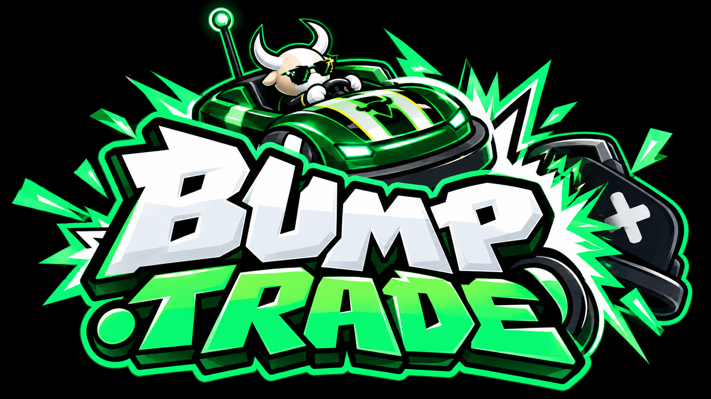

# BUMP.TRADE

<p align="center"></p>

**HIT THEIR CAR. TAKE THEIR CASH. TRY NOT TO GET LIQUIDATED.**

Real-time 3D bumper-car wager arena on **Monad testnet** (chain id 10143). Every player stakes 100 free `BUMP` and starts with a balance. Every hit moves balance from the car you hit to you (harder, faster, better-angled hits take more); drop to zero and you are liquidated and out. When the round ends, each player is paid `stake x final balance / start balance` from the pot, on-chain, in **one transaction**. Play is gasless: a player signs one EIP-712 message and the game server relayer pays all gas.

> Testnet demo. Free test tokens, no real funds. Not affiliated with, endorsed by, or connected with any company or ticker shown.

- Live demo: https://bump-monad.vercel.app
- Demo video: https://youtu.be/tjQsDo-kLpA
- Game server: https://server-production-54bd.up.railway.app (`/health`, `/ready`, `/metrics.json`)

Built for the Monad Metropolis Hackathon.

## How it uses Monad

| Item | Value |
|---|---|
| Network | Monad testnet, chain id 10143, native token MON |
| `BumpArena` (escrow + settlement) | [`0xCB574c46A3579Cf56F398F42A51BFE4C0f1459d9`](https://testnet.monadvision.com/address/0xCB574c46A3579Cf56F398F42A51BFE4C0f1459d9) |
| `MockBUMP` (free test ERC20) | [`0xF094E7e6cB7B9297a88F19E5209C0D6DE3616666`](https://testnet.monadvision.com/address/0xF094E7e6cB7B9297a88F19E5209C0D6DE3616666) |
| Example settle tx | [`0x90fcb37c…05a4`](https://testnet.monadvision.com/tx/0x90fcb37c394bb37cd346be1993f634b450676e805970b1ad667cbed53e4705a4) (block 70044099, about 130k gas) |

How the game leans on Monad:
- **One transaction per match.** The server signs the final result (EIP-712) and a single `settle` call pays every player, so settlement cost does not grow with the number of rounds or collisions played.
- **Gasless onboarding.** Players never hold MON. They sign a typed-data `JoinIntent`; the relayer submits `joinWithSig` and pays the gas.
- **Cheap, frequent settlement.** Matches last 90 seconds, so many short matches settle per hour. That only works economically on a fast, low-fee chain.
- **Trust-minimised escrow.** Stakes sit in the `BumpArena` contract. If the server never settles, any player can call `claimRefund` after the settle window.

Deployment record: `contracts/deployments/10143.json`.

## Architecture

```
 Browser (Vite + three.js + Rapier)            Railway                           Monad testnet (10143)
 ┌───────────────────────────────┐  ws/http   ┌──────────────────────────┐  RPC  ┌──────────────────────┐
 │ 3D client, wallet connect     │───────────▶│ Colyseus game server     │──────▶│ BumpArena (escrow,   │
 │ (EIP-1193 / EIP-6963)         │            │ - 60 Hz Rapier physics   │       │  joinWithSig, settle,│
 │ signs EIP-712 JoinIntent only │◀───────────│ - 30 Hz snapshots        │       │  claimRefund)        │
 └───────────────────────────────┘ snapshots  │ - relayer (pays gas)     │       │ MockBUMP (faucet)    │
                                              │ - signs the match Result │       └──────────────────────┘
                                              │ - leaderboard (memory/PG)│
                                              └──────────────────────────┘
```

- **Client** (`src/`): Vite + three.js + Rapier. Offline mode against AI bots, plus an online mode with wallet connect, a free `BUMP` faucet and one-signature join.
- **Game server** (`server/`): Colyseus 0.18. Authoritative simulation, relays gasless joins (`joinWithSig`), signs the match result, settles on-chain, serves the leaderboard and the faucet.
- **Contracts** (`contracts/`): Foundry, Solidity 0.8.33. `BumpArena` escrows `BUMP` stakes, verifies the signed result and pushes payouts; `MockBUMP` is a free ERC20 with a 24 h faucet. 109 tests (unit, fuzz, invariant, EIP-712 vectors).
- **Shared** (`packages/shared/`): protocol schemas, message types and the deterministic game rules used by server and client.
- **Indexer** (`indexer/`, optional): Ponder indexer for arena events.
- **E2E** (`tools/e2e/monad-local/`): two real browsers with mock EIP-1193 wallets against the live deployment.

## Technology stack

TypeScript, Vite, three.js, Rapier (WASM physics), Colyseus 0.18 (WebSocket multiplayer), viem 2, Solidity 0.8.33, Foundry, OpenZeppelin Contracts 5.6 (vendored in `contracts/lib`), Ponder (optional), Postgres (optional, leaderboard), Railway (server) and Vercel (static client).

## Verified end to end

`tools/e2e/monad-local` plays a full match with two browsers against the live client, live server and Monad testnet and checks: wallet connect, on-chain faucet mint, one-signature gasless join (player MON balance unchanged), stake escrowed in the arena, authoritative match, on-chain settle with payouts, empty vault, leaderboard, and no browser console errors (11 checks).

```bash
# start a headless Chrome with --remote-debugging-port=9444, then:
E2E_CLIENT=https://bump-monad.vercel.app/ E2E_SERVER=https://server-production-54bd.up.railway.app \
  node tools/e2e/monad-local/e2e.mjs
```

## Setup

Requirements: Node >= 22.12, pnpm 11, Foundry, Google Chrome (E2E only).

```bash
git clone <this-repo> && cd BumpTrade-Monad
pnpm install
cp .env.example .env            # fill in values; never commit .env
```

Run locally against Monad testnet (needs a funded relayer key and a signer key, see `server/README.md` for every variable):

```bash
# terminal 1: game server
RELAYER_PRIVATE_KEY=... SIGNER_PRIVATE_KEY=... \
ARENA_ADDRESS=0xCB574c46A3579Cf56F398F42A51BFE4C0f1459d9 \
TOKEN_ADDRESS=0xF094E7e6cB7B9297a88F19E5209C0D6DE3616666 \
pnpm --filter @bump/server start

# terminal 2: client (set VITE_GAME_SERVER_URL=ws://localhost:2567, VITE_ARENA_ADDRESS, VITE_TOKEN_ADDRESS)
pnpm dev                        # http://localhost:5173
```

Checks:

```bash
pnpm build && pnpm typecheck:all && pnpm test:all
cd contracts && forge test
```

Deploy your own contracts (testnet MON from https://faucet.monad.xyz):

```bash
cd contracts
export OWNER_ADDRESS=... SIGNER_ADDRESS=... OPERATOR_ADDRESS=... TREASURY_ADDRESS=...
forge script script/Deploy.s.sol --rpc-url https://testnet-rpc.monad.xyz --chain-id 10143 \
  --private-key $DEPLOYER_PRIVATE_KEY --broadcast
node script/record-deployment.mjs   # writes deployments/10143.json
```

The server image is `Dockerfile.server` (Railway). The client builds with `pnpm build` into `dist/` and runs on any static host. Environment variable names are in `.env.example`, `server/README.md` and `contracts/README.md`.

## Build window, pre-existing work and AI disclosure

- **Build window.** All code in this repository was written during the hackathon period. The game core (3D client, Rapier simulation, Colyseus server, EIP-712 gasless join, escrow contracts) was first built between 2026-10-06 and 2026-10-10 and is visible in the earlier commit history, which first targeted another EVM testnet and then Solana. The **Monad-specific work** was done on 2026-10-11: retargeting to chain 10143, deploying `MockBUMP` and `BumpArena`, removing the other chains, the Monad E2E harness, hosting and this documentation. A Solana devnet version exists in a separate repository (`Vamp-Labs/BumpTrade`).
- **Pre-existing components** are limited to open-source dependencies (see attribution) and the earlier history of this repository. No code from earlier products was reused.
- **AI coding tools.** The project was developed with AI coding agents (Claude Code) under the author's direction: roles, interfaces and acceptance tests were specified up front, and all code was verified by running the test suites and the end-to-end checks. The 3D vehicle models were created with Blender scripting.

## Attribution

OpenZeppelin Contracts (MIT), forge-std (MIT/Apache-2.0), three.js (MIT), Rapier (Apache-2.0), Colyseus (MIT), viem (MIT), Vite (MIT), Ponder (MIT). Licenses of all dependencies are in their packages and lockfiles.

## License

MIT, see `LICENSE`.
